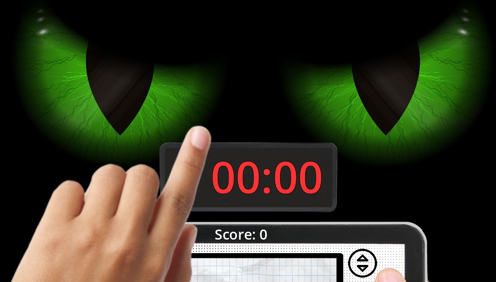
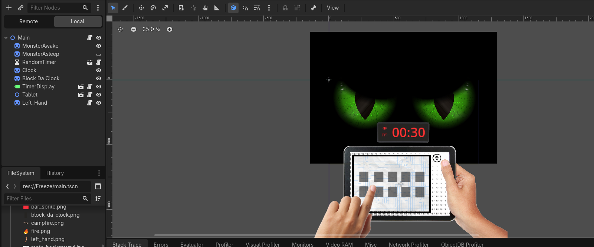
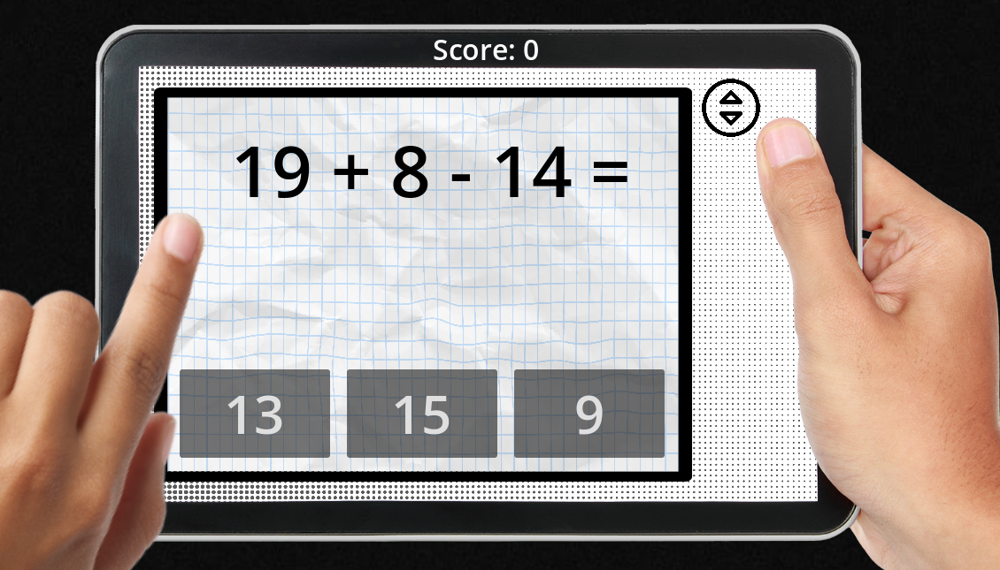
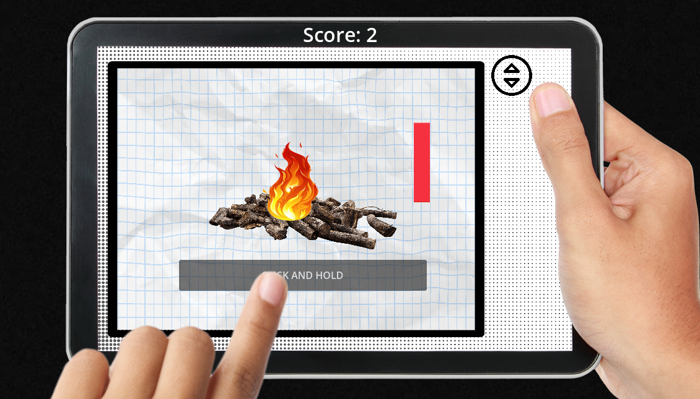
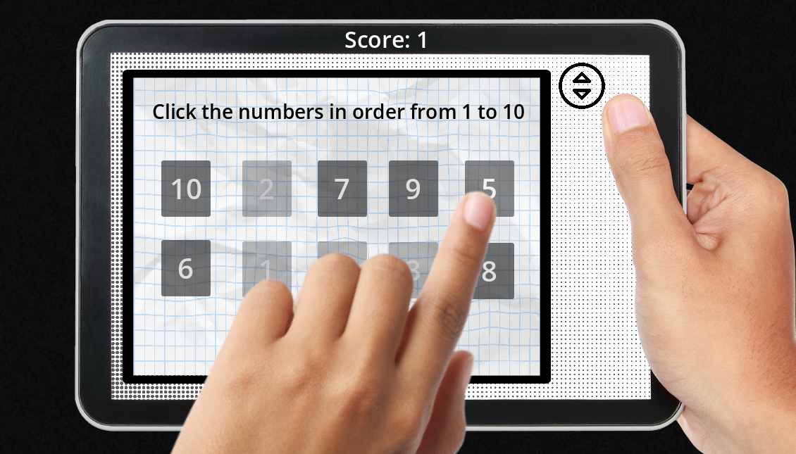
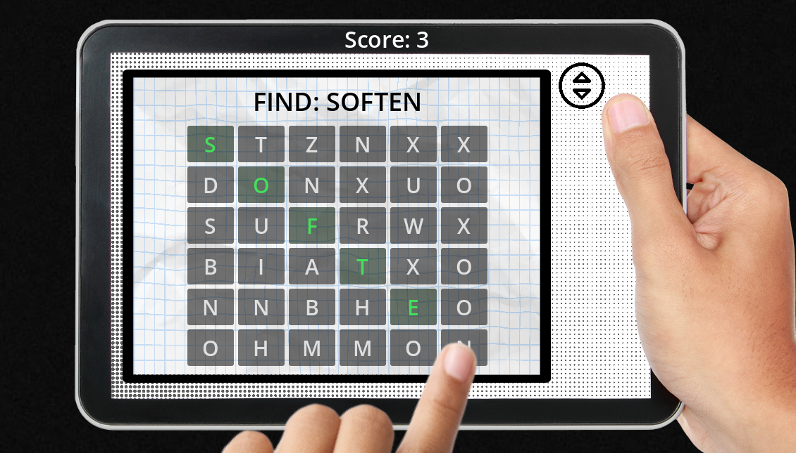

# OnWatch
## Premise 
You have to save your completely frozen over town while a monster is after you! Can you do it?
Here's how it works : 
- You'll be working on a puzzle that'll defrost your town and save everyone
- However, a monster will be hunting you : so you have to be on the look out for that
- There'll be a timer running in the background, you'll be unable to view the timer as you work; but you'll able to hear the timer as you work
- Slide up the puzzle before the timer ends and stop moving entirely (aka stop clicking around)

In essence : Work on your puzzle + occasionally look up and stop moving to avoid the monster's detection

Can you do it? Can you save your town?

**Live Demo**: https://who-li.itch.io/onwatch

**Made by**: Juli (@julietasegovia) and Amrita (@ashokamrita07-sys)

## How it works
We made this game using GODOT

### Timer & Gameflow
We have an alarm component that runs a countdown. The countdown's timer is a random ammount between 10 and 30 seconds. The timer is synced with an audio cue (a clocks tick) each second that passes giving the player a cue on how much time they have left.

The game tracks the cursor input for solving the puzzles, it recieves no other input. Once the timer's out the alarm sound goes off and the player will loose if a cursor input is detected. The alarm and the freezing state both last 5 seconds before the timer resets and the monster goes back to sleep.

The monster is represented by a background image. That's just a sprite that pops up while the alarm goes off.

### Puzzles
A win on any puzzle will take you to the next puzzle
#### Math Puzzle
The tablet shows an equation like a + b - c. Three buttons appear: one is the right answer, and the other two are random wrong numbers. A wrong click replaces the equation and answers.

#### Campfire Puzzle
The digits 1 through 10 are shuffled on ten buttons. You click them in order, starting at 1. A wrong number turns every button back on and you start again at 1.

#### Scrambled Numbers Puzzle
Hold the button for 10 seconds. The flame grows and the heat bar fills while you hold. Letting go drains the bar slowly. 

#### Word Search Puzzle
We have a Word Search in which your task is to find a keyword! Each time you play, your wordsearch will load with each time you receive the minipuzzle having a randomized chance of the keyword being one of the following words : {halt, melt, frost, soften, reheat}. 

### Menu & Leaderboard
Our title page includes a FNAF 2 style menu with chilly elements (i.e icicle) to fit Snowglobe's Freeze theme! In addition, you can access a leaderboard on the menu to see previous players' scores. From here in order to play the game you must type your name (must be 3 letters long) and then you're off! When you lose, you have the option to return to the menu (where you could then go to the leaderboard and see your ranking among other players). 
